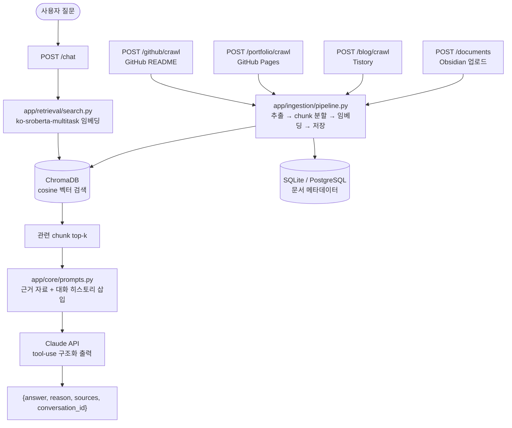

# Personal Career Knowledge Agent

Obsidian, 블로그, 포트폴리오, GitHub에 분산된 개발 경험과 학습 기록을 하나로 통합해 검색하는 개인 지식 RAG(Retrieval-Augmented Generation) 서비스입니다.

사용자가 질문하면 실제로 쌓아온 노트/글/프로젝트에서 관련 내용을 검색하고, 그 내용에 근거한 답변과 출처(파일명 또는 URL)를 함께 반환합니다.

## 아키텍처



데이터 수집(ingestion)은 4개 소스를 지원하며, 모두 공통 파이프라인(`app/ingestion/pipeline.py`)을 거쳐 텍스트 추출 → chunk 분할 → 임베딩/벡터 저장 → 메타데이터 DB 저장 순으로 처리됩니다.

| 소스 | 엔드포인트 | 수집 방식 |
|---|---|---|
| Obsidian / 파일 업로드 | `POST /documents` | PDF/TXT/MD 파일 업로드 |
| Tistory 블로그 | `POST /blog/crawl` | `sitemap.xml` 기반 전체 글 크롤링 |
| GitHub Pages 포트폴리오 | `POST /portfolio/crawl` | 페이지의 `<section id="...">`별로 분리 수집 |
| GitHub README | `POST /github/crawl` | 사용자의 non-fork 저장소 README 전체 수집 |

## 스크린샷

> TODO: 서버 실행 후 `http://127.0.0.1:8000/docs`(Swagger UI)와 실제 `/chat` 호출 결과 스크린샷을 추가하세요. 이 세션에는 브라우저 자동화 도구가 연결되어 있지 않아 실제 캡처는 하지 못했습니다 — `/chrome`으로 Claude in Chrome을 연결하면 다음 세션에서 자동으로 캡처할 수 있습니다.

## 설치

```bash
python -m venv .venv
.venv\Scripts\activate
pip install -r requirements.txt
```

## 환경 변수

`.env.example`을 복사해 `.env`를 만들고 값을 채우세요.

```bash
cp .env.example .env
```

| 변수 | 필수 | 설명 |
|---|---|---|
| `ANTHROPIC_API_KEY` | 필수 | `/chat`의 Claude API 호출에 사용 |
| `DATABASE_URL` | 선택 | 설정하면 이 URL로 문서 메타데이터 DB에 연결 (예: PostgreSQL). 미설정 시 로컬 SQLite(`data/metadata.db`) 사용 |
| `POSTGRES_USER` / `POSTGRES_PASSWORD` / `POSTGRES_DB` | 선택 | `docker-compose.yml`의 `db`(PostgreSQL) 서비스 초기 설정값 |

## 실행

### 로컬 (venv)

```bash
uvicorn app.main:app --reload
```

서버가 뜨면 `http://127.0.0.1:8000`에서 바로 채팅 UI가 열립니다 — 별도 도구 없이 브라우저에서 질문하고 답변·출처를 확인할 수 있습니다. API를 직접 호출/테스트하려면 `http://127.0.0.1:8000/docs`(Swagger UI)를 사용하세요. (`sentence-transformers`/`torch` 임포트 때문에 첫 기동에 10~15초 정도 걸릴 수 있습니다.)

### Docker Compose (app + PostgreSQL)

```bash
docker compose up --build
```

`app` 서비스가 `db`(PostgreSQL) 서비스의 헬스체크를 기다린 뒤 기동하며, `DATABASE_URL`이 자동으로 PostgreSQL을 가리키도록 설정됩니다. `./data`, `./logs`는 호스트에 바인드 마운트되어 컨테이너를 재생성해도 수집한 데이터가 보존됩니다.

> Docker 이미지/컴포즈 구성은 작성했지만 이 개발 환경에는 Docker가 설치되어 있지 않아 실제 빌드·실행 검증은 하지 못했습니다.

## API

**서버 상태 확인**

```bash
curl http://127.0.0.1:8000/health
```

```json
{"status": "healthy", "service": "personal-career-knowledge-agent"}
```

**질문하기**

```bash
curl -X POST http://127.0.0.1:8000/chat \
  -H "Content-Type: application/json" \
  -d "{\"message\": \"싱글톤 패턴이 뭐야?\"}"
```

```json
{
  "answer": "...",
  "reason": "...",
  "sources": [{"filename": "cs_singleton.md", "source_url": null}],
  "conversation_id": "3f9b1c2e-..."
}
```

같은 대화를 이어가려면 다음 요청에 `conversation_id`를 그대로 실어 보내면 됩니다. 실제 검색/답변 예시는 [`demo.md`](demo.md)를 참고하세요.

**직접 검색하기**

```bash
curl -X POST http://127.0.0.1:8000/search \
  -H "Content-Type: application/json" \
  -d "{\"query\": \"싱글톤 패턴이 뭐야?\", \"top_k\": 5}"
```

```json
{"query": "...", "results": [{"chunk_id": "...", "document_id": "...", "chunk_index": 0, "text": "...", "similarity": 0.59, "filename": "cs_singleton.md", "source_url": null}]}
```

**최근 대화 로그 조회**

```bash
curl "http://127.0.0.1:8000/logs?limit=5"
```

```json
[{"timestamp": "...", "message": "...", "answer": "...", "response_time_ms": 812.4}]
```

**문서 업로드 (PDF/TXT/MD)**

```bash
curl -X POST http://127.0.0.1:8000/documents -F "file=@notes.md"
```

```json
{"document_id": "...", "filename": "notes.md", "size_bytes": 123, "status": "uploaded", "text_length": 118, "chunk_count": 1}
```

```bash
curl http://127.0.0.1:8000/documents
```

**블로그 / 포트폴리오 / GitHub 크롤링**

```bash
curl -X POST http://127.0.0.1:8000/blog/crawl -H "Content-Type: application/json" -d "{\"blog_url\": \"https://your-blog.tistory.com\"}"
curl -X POST http://127.0.0.1:8000/portfolio/crawl -H "Content-Type: application/json" -d "{\"portfolio_url\": \"https://your-id.github.io\"}"
curl -X POST http://127.0.0.1:8000/github/crawl -H "Content-Type: application/json" -d "{\"username\": \"your-github-id\"}"
```

세 엔드포인트 모두 `{crawled_count/section_count, ..., failed: [...]}` 형태로, 개별 항목 실패는 전체 요청을 막지 않고 `failed` 목록에 사유와 함께 담겨 돌아옵니다.

## 테스트

```bash
pytest
```

## 평가 (RAG 품질)

`eval_dataset.json`(30문항, 4개 소스 전체를 커버)로 검색·프롬프트 튜닝을 진행했습니다.

- `scripts/eval_chunk_size.py` → `docs/eval_chunk_size.md`: chunk size 비교
- `scripts/eval_top_k.py` → `docs/eval_top_k.md`: top-k 비교
- `prompt_log.md`: 프롬프트 변경 이력과 근거
- `eval_report.md`: 종합 결론 (top_k=5→10으로 실제 반영)

## 프로젝트 구조

```
app/
├── main.py              # FastAPI 앱, 전체 엔드포인트
├── core/                 # 프롬프트, 대화 히스토리, 채팅 로그
├── ingestion/             # 업로드/크롤링, 파싱, chunk 분할, 메타데이터 DB, 공통 파이프라인
├── retrieval/             # 임베딩, 벡터 스토어(Chroma), 검색
├── services/              # Claude API 클라이언트
└── schemas/               # Pydantic 요청/응답 모델
scripts/                   # 검색 품질 평가 스크립트 (chunk size / top-k 비교)
tests/                      # pytest
```

## 구현 범위 (현재)

- FastAPI 서버: `/health`, `/chat`, `/search`, `/logs`, `/documents` (GET/POST), `/blog/crawl`, `/portfolio/crawl`, `/github/crawl`
- 4개 소스 수집 파이프라인 (Obsidian 업로드, Tistory 블로그, GitHub Pages 포트폴리오, GitHub README), 공통 ingest 헬퍼(`app/ingestion/pipeline.py`)
- chunk 분할(`app/ingestion/chunker.py`) → 로컬 한국어 임베딩(`ko-sroberta-multitask`) → ChromaDB(cosine 유사도) 색인/검색
- 문서 메타데이터 SQLite/PostgreSQL 저장 (`app/ingestion/metadata_db.py`, `DATABASE_URL`로 전환 가능)
- RAG `/chat`: 검색 결과를 프롬프트에 근거로 주입, 근거 없는 질문에는 "모른다"고 답하도록 유도하는 프롬프트 규칙, 실제 검색된 chunk 기반 `sources` 반환, `conversation_id` 기반 멀티턴 대화
- 질문/응답/응답시간 로그 저장 및 조회
- 검색 품질 평가셋과 chunk size/top-k 튜닝 (`eval_dataset.json`, `eval_report.md`)
- Dockerfile + docker-compose (app + PostgreSQL), `.env.example`
- 웹 채팅 UI (`GET /`, `app/static/index.html`) — 별도 프레임워크/빌드 없이 순수 HTML/CSS/JS로 구현, 답변과 함께 출처를 보여주고 `conversation_id`로 대화를 이어감
- pytest 테스트 (69개, `tests/`)

## 알려진 한계

- 이 개발 환경에는 Docker가 설치되어 있지 않아 Dockerfile/docker-compose는 빌드·실행 검증을 하지 못했습니다 (구성 자체는 `docker-compose config` 문법 검증만 통과).
- `/chat`의 실제 LLM 응답 품질(hallucination 여부 등)은 `ANTHROPIC_API_KEY`가 있어야 측정할 수 있습니다 — 현재까지의 튜닝(top_k 등)은 검색 hit-rate 기준입니다. 자세한 내용은 `eval_report.md` 참고.

## 다음 작업

- `ANTHROPIC_API_KEY` 확보 후 `/chat` 실제 답변 품질 측정
- 실제 Docker 환경에서 Dockerfile/docker-compose 빌드·실행 검증
- 스크린샷 캡처 (`/chrome`으로 브라우저 도구 연결 후)
